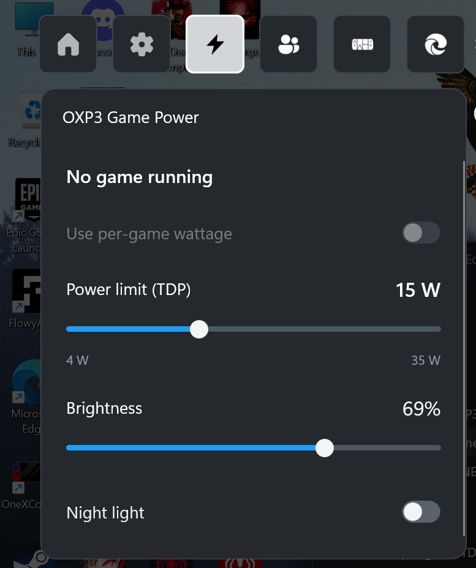

# OXP3 Game Power

Per-game TDP, brightness, HDR, Night light, and Keep awake in a controller-friendly Xbox Game Bar widget for the ONEXPLAYER 3.

We built this because ONEXConsole's TDP controls are awkward to use while playing, and the ONEXPLAYER 3's Xbox fullscreen experience lacks quick brightness and Night light controls.

This app is in alpha. If you run into trouble, [open an issue](https://github.com/mirana21/oxp-game-bar/issues/new) with what happened and any error message. You can uninstall it using the [removal steps below](#update-or-remove).

## Install

1. Download the ZIP from [Releases](https://github.com/mirana21/oxp-game-bar/releases) and extract it.
2. Run **Setup.exe** and choose **Install / Repair**.
3. Open Xbox Game Bar → **Widgets** → **OXP3 Game Power**.

## Update or remove

Updates install automatically from GitHub when no game is detected and the widget is closed. You can also run **Setup.exe** and choose **Install / Repair**.

To remove, choose **Remove** in Setup or uninstall **OXP3 Game Power** from Windows Installed apps. Uninstalling restores normal ONEXConsole startup. Saved wattages are retained for reinstall.

## Release history

### [0.1.0.31](https://github.com/mirana21/oxp-game-bar/releases/tag/v0.1.0.31)

- Added an HDR toggle with controller support.
- Night light strength now takes effect without manually switching Night light off and on.

### [0.1.0.30](https://github.com/mirana21/oxp-game-bar/releases/tag/v0.1.0.30)

- Added automatic updates from GitHub and Keep awake.
- Fixed compatibility with ONEXConsole updates and recovery when they replace its startup task.

### [0.1.0.27](https://github.com/mirana21/oxp-game-bar/releases/tag/v0.1.0.27)

- First public release: per-game TDP, brightness and Night light in Xbox Game Bar.
